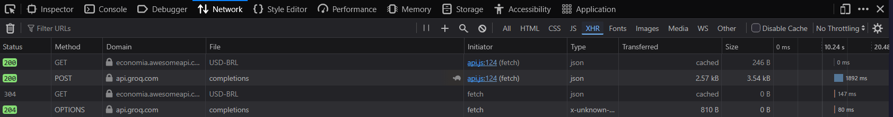

# FreelaScope AI — Calculadora de Escopo e Orçamento para Desenvolvimento Web & Software

**Autor:** [Keven Gomes](https://github.com/KevenGustavo)  
**Disciplina:** Desenvolvimento de Sistemas Web (EECP0036) · Turma 24N12 · 2026.2  
**Universidade Federal do Maranhão (UFMA)** — Engenharia da Computação  
**Professor:** Renan Sousa Freire  
**Tema Escolhido:** 8. Calculadora de Projetos | **Trilha:** A (API de IA) + Câmbio em Tempo Real

---

## 1. Descrição do App
O **FreelaScope AI** é um workbench web desenvolvido para desenvolvedores freelancers estimarem com precisão técnica e financeira o custo e o cronograma de aplicações web e sistemas de software. A ferramenta utiliza Inteligência Artificial para realizar a decomposição técnica da Estrutura Analítica do Projeto (WBS - *Work Breakdown Structure*), delega a matemática financeira determinística a um motor local em JavaScript aplicando margem de segurança de **+20%**, consulta a cotação comercial do Dólar (`USD-BRL`) em tempo real e armazena o histórico de propostas localmente no navegador.

---

## 2. Exemplo de Uso Concreto

1. **Entrada do Usuário:**
   - O desenvolvedor seleciona o nível **Dev Pleno** (taxa horária de `R$ 100/h`).
   - Clica no preset rápido **"E-commerce Web"** ou seleciona os chips de stack `[Landing Page / UI Responsiva]`, `[API REST]`, `[Banco de Dados SQL]`, `[Autenticação/JWT]` e `[Gateway de Pagamento]`.
   - Digita no campo de requisitos: *"Plataforma web de vendas com catálogo de produtos, carrinho persistente, autenticação de clientes e checkout transparente via Pix e cartão."*
   - Clica no botão **"Gerar Escopo Técnico (WBS) e Orçamento"** (ou atalho `Ctrl + Enter`).
2. **Processamento:**
   - O app consulta em paralelo a API de IA (decompondo o sistema em entregáveis técnicos com horas inteiras) e a AwesomeAPI (obtendo a cotação comercial do dólar, ex: `R$ 4.97`).
   - O motor matemático soma as horas (ex: `64 horas`), calcula o Custo Base (`R$ 6.400,00`), aplica a margem de risco de +20% (`R$ 1.280,00`), obtém o Investimento Final (`R$ 7.680,00`) e converte para moeda internacional (`US$ 1,545.27`).
3. **Resultado Exibido:**
   - É renderizada uma **Proposta Técnica e Comercial** com métricas destacadas, tabela detalhada dos módulos WBS com graus de complexidade (`Baixa`, `Média`, `Alta`) e ação para salvar no histórico local com prevenção contra duplicatas.

---

## 3. O que o App Faz e o que Não Faz

### O que o app FAZ:
- Decompõe requisitos textuais de software em módulos técnicos (WBS) com estimativa de horas inteiras calibradas para freelancers.
- Executa cálculo financeiro determinístico em JavaScript puro: $\text{Total} = (\sum \text{Horas} \times \text{Taxa/Hora}) \times 1.20$.
- Consulta a cotação comercial do Dólar em tempo real (`USD-BRL`) via AwesomeAPI pública.
- Permite **recálculo instantâneo em tempo real**: alterar a senioridade ou a taxa horária de uma proposta aberta recalcula os totais em BRL e USD imediatamente sem gastar nova chamada de IA.
- Salva, lista, restaura e exclui estimativas no `localStorage` com detecção inteligente de duplicatas.

### O que o app NÃO FAZ:
- Não possui backend próprio nem sistema de login/banco de dados em servidor (arquitetura 100% *client-side*).
- Não emite notas fiscais, cobranças bancárias reais nem gera contratos jurídicos em PDF.
- Não sincroniza o histórico entre diferentes navegadores ou computadores (persistência restrita ao navegador local).

---

## 4. Como Funciona (Passo a Passo)

```
[Clique no Botão]
       ↓
(1) Validação Defensiva: Valida se a descrição e o valor/hora são válidos (evita campos vazios).
       ↓
(2) Requisições Paralelas (Promise.all):
    ├── POST na API de IA: Decompõe o escopo em JSON estruturado com horas inteiras e complexidade.
    └── GET na AwesomeAPI: Obtém o câmbio comercial USD-BRL em tempo real.
       ↓
(3) Motor Matemático Local: Soma horas inteiras, aplica taxa/hora, calcula +20% de margem e converte para USD.
       ↓
(4) Inserção Segura no DOM: Renderiza a proposta e tabela WBS clonando <template> e usando textContent (Zero innerHTML).
```

---

## 5. Tecnologias Utilizadas e Travas Inegociáveis

- **HTML5 Semântico:** Estruturação através de tags nativas (`<header>`, `<main>`, `<section>`, `<article>`, `<table scope="col">`, `<template>`, `<label for="...">`).
- **CSS3 Puro e Responsivo:** Design System próprio (*Precision Workbench*) utilizando variáveis CSS, Flexbox, CSS Grid, tipografia tabular (`tabular-nums`), espaçamentos fluidos com `clamp()` e **CSS Container Queries** (`container-type: inline-size`) para responsividade adaptativa em celulares (`320px+`), tablets e desktops. **Zero frameworks ou bibliotecas de UI (sem Bootstrap, Tailwind, etc.)**.
- **JavaScript Vanilla Moderno (ES Modules):** Código modularizado em módulos nativos sem etapas de *bundling* ou dependências npm:
  - `js/main.js`: Orquestração de eventos e renderização segura no DOM.
  - `js/api.js`: Comunicação paralela com a API de IA e AwesomeAPI com camada de idempotência e timeout.
  - `js/calculator.js`: Motor matemático determinístico e formatadores `Intl.NumberFormat`.
  - `js/fallback.js`: Motor de contingência (Plano B) com templates de projetos web e heurística contextual.
  - `js/storage.js`: CRUD no `localStorage` com assinatura canônica contra duplicatas.
- **Segurança Estrita Anti-XSS:** Proibição absoluta de `.innerHTML` em todo o código. Uso exclusivo de `textContent`, `replaceChildren()` e clonagem de `<template>`. Proteção reforçada por *Content Security Policy* (CSP) restritiva.

---

## 6. Como Rodar a Aplicação Localmente

### Pré-requisitos
Apenas um navegador web moderno e Python 3 (ou extensão *Live Server* no VS Code).

### Passo a Passo

1. **Clone o repositório:**
   ```bash
   git clone https://github.com/KevenGomes/freelascope-ai.git
   cd freelascope-ai
   ```

2. **(Opcional) Configuração da Chave de API de IA:**
   - Copie o arquivo modelo:
     ```bash
     cp js/config.example.js js/config.js
     ```
   - Abra `js/config.js` e insira sua chave da Groq, OpenRouter ou Google AI Studio:
     ```javascript
     export const AI_API_URL = "https://api.groq.com/openai/v1/chat/completions";
     export const AI_MODEL = "openai/gpt-oss-120b";
     export const AI_API_KEY = "sua_chave_aqui";
     ```
   > **Nota:** Caso opte por não configurar nenhuma chave, a aplicação funcionará normalmente utilizando o **Plano B automático** (`js/fallback.js`).

3. **Inicie o servidor HTTP local:**
   ```bash
   python3 -m http.server 8000
   ```

4. **Acesse no navegador:**
   Abra `http://localhost:8000` (ou `http://127.0.0.1:8000`).

---

## 7. Declaração do Plano B (Resiliência)

Em conformidade com a **Seção 5** do documento da disciplina:
- Caso o arquivo `js/config.js` não exista (comportamento padrão ao clonar do GitHub), a chave esteja vazia, a conexão de rede caia ou o provedor retorne timeout/erro HTTP (ex: 402, 429, 500), a aplicação **não trava a interface**.
- O módulo [`js/api.js`](js/api.js) intercepta o cenário via `try/catch` e aciona de forma transparente o motor de contingência [`js/fallback.js`](js/fallback.js), gerando uma Estrutura Analítica do Projeto (WBS) completa, coerente com as palavras-chave e chips de stack selecionados, exibindo um banner informativo de contingência na proposta gerada.

---

## 8. Evidência da Aba Rede (Network)

Conforme exigido nas **Seções 4 e 6** do documento da disciplina, a imagem abaixo comprova o funcionamento das requisições externas na aba Rede (DevTools - F12) ao submeter um projeto com status HTTP 200:



> **Explicação Técnica da Aba Rede:**  
> A captura de tela evidencia duas requisições executadas simultaneamente via `Promise.all`:  
> 1. Uma requisição **POST** com status **`200 OK`** para a API de IA (`api.groq.com/openai/v1/chat/completions`), enviando os requisitos técnicos do sistema e recebendo a decomposição WBS em formato JSON estrito.  
> 2. Uma requisição **GET** com status **`200 OK`** para a AwesomeAPI (`economia.awesomeapi.com.br/json/last/USD-BRL`), obtendo a cotação comercial mais recente do Dólar para conversão da proposta.

---

## 9. Declaração Obrigatória de Uso de Inteligência Artificial

Em estrito cumprimento à **Seção 8** do documento da disciplina:

- **Ferramenta de IA Utilizada:** Google Antigravity (Gemini 3.8 Flash).
- **O que foi solicitado à IA:**
  - Elaboração da estrutura base semântica HTML5 e componentes de formulário da calculadora de projetos.
  - Implementação dos módulos de lógica em Vanilla JS (cálculo financeiro com margem de +20%, requisição paralela de APIs externas e gerenciamento de histórico no `localStorage`).
  - Criação de testes automatizados com Node.js para validação das fórmulas matemáticas e do fluxo de contingência.
- **O que foi alterado e personalizado manualmente:**
  - **Refatoração Completa de UI/UX:** Eliminação de padrões genéricos de IA (remoção de todos os emojis, eliminação de gradientes roxo/azul artificiais e adoção de paleta técnica *Zinc & Cobalt* com tipografia tabular `tabular-nums`).
  - **Criação de Ícone Autoral SVG:** Criação do ícone em `favicon.svg` unindo a metáfora visual de cantoneiras de escopo (*Scope*) a barras de decomposição de tarefas (*WBS*).
  - **Responsividade Avançada com Container Queries:** Substituição de media queries fixas por `@container` queries em CSS puro para ajuste perfeito em qualquer largura de tela.
  - **Deduplicação de Histórico e Idempotência:** Implementação da verificação de assinatura canônica no `storage.js` para impedir que o mesmo orçamento seja salvo mais de uma vez e inclusão de cache de idempotência com `temperature: 0` e `seed: 42` na API.
  - **Parametrização Genérica de IA:** Refatoração de `api.js` para aceitar qualquer endpoint e modelo compatível configurado no `config.js`, sem hardcoding de provedor.

